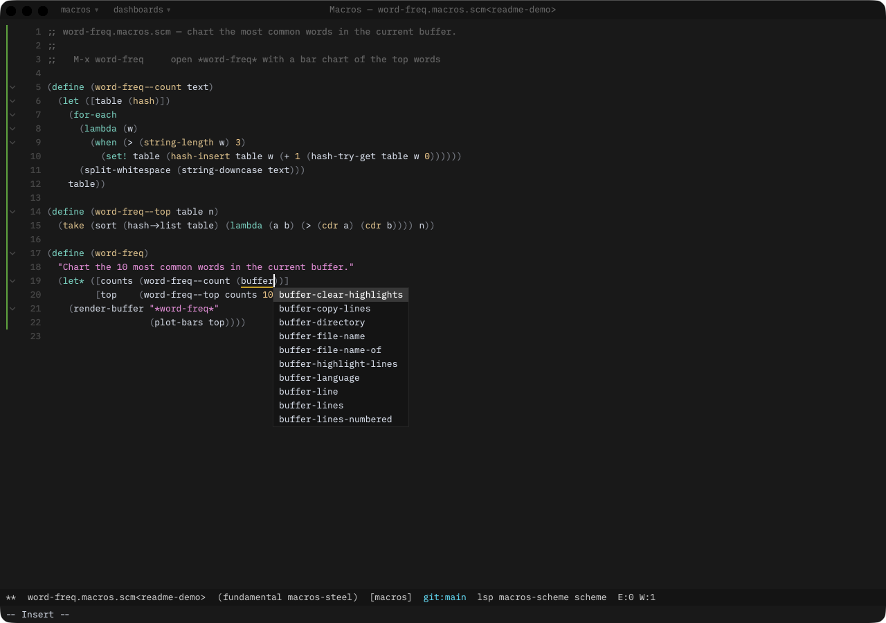
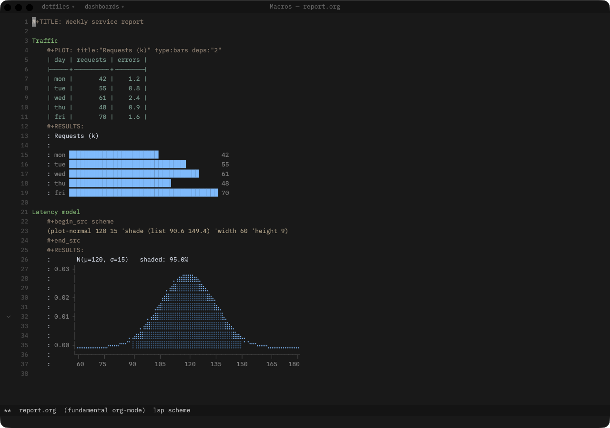
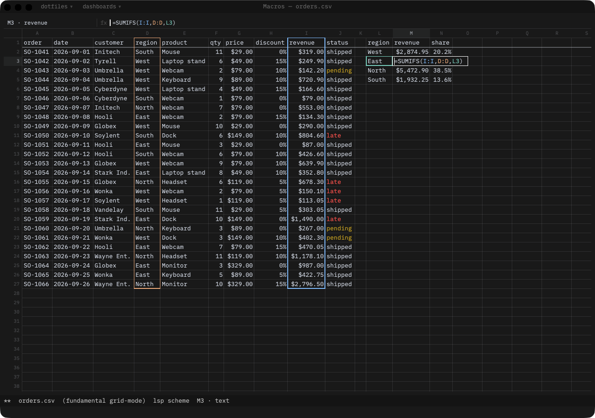

# Macros

Macros is a code editor that works like Emacs, renders on the GPU, and is scripted in [Steel](https://github.com/mattwparas/steel), a fast embedded Scheme. Like Emacs, it's written in its own extension language, so you can change any part of it while it runs. Magit, evil, helix, Org mode, LSP, a debugger, and a terminal ship in the box. It runs on macOS, Linux, and Windows.



## What's in it

- **Steel all the way down.** Your config, most modes, and every package are Steel. Evaluate a form in place and the running editor picks it up. Config and package files get a built-in language server that knows the whole editor API, so you get completion, docs, and diagnostics for every editor function.
- **Your keys.** Emacs bindings by default, or evil (Vim) or helix modal editing.
- **The usual tools.** A Magit-style git porcelain, Org mode with agenda, capture, tables, and babel, language servers for other languages, a debugger (DAP), Helm, Dired, and a VT terminal in a buffer.
- **Spreadsheets.** Open a CSV, TSV, or `.xlsx` as a grid with formulas, number formats, and conditional highlighting, then flip back to the raw text with one key.
- **Charts made of text.** Sparklines, bars, line and scatter plots, histograms, distributions, and heatmaps drawn with braille and block glyphs. Because a chart is just text, it works anywhere text does: an Org file, a dashboard, the REPL.





## Getting it

Prebuilt, signed builds are on the [downloads page](https://macros.dev/download). On macOS the app updates itself. On Linux and Windows it tells you when there's a new version.

If you'd rather build it yourself, you need Rust. The toolchain is pinned in `rust-toolchain.toml`, so rustup will grab the right version for you.

```sh
git clone https://github.com/macros-app/macros
cd macros
cargo run --release
```

On Debian or Ubuntu you'll also need a few system libraries first:

```sh
sudo apt-get install build-essential pkg-config cmake perl \
  libwayland-dev libxkbcommon-dev libxkbcommon-x11-dev \
  libxcb1-dev libxcb-render0-dev libxcb-shape0-dev libxcb-xfixes0-dev \
  libfontconfig1-dev libfreetype6-dev libvulkan-dev libssl-dev
```

## First steps

When you first open it, press `C-h t` for the built-in tutorial. `M-x` lists every command and `C-h b` shows every key that's currently bound.

Your config is just a Steel program at `~/.config/macros/init.scm` (or under `$XDG_CONFIG_HOME` if you set it). It runs after the defaults load, so you can override anything you like. The [docs](https://macros.dev/docs) go into much more detail on configuration, scripting, and every built-in mode.

## Contributing

Bug reports and ideas are welcome in [GitHub issues](https://github.com/macros-app/macros/issues). Pull requests are welcome too. Please read [CONTRIBUTING.md](CONTRIBUTING.md) first. The short version is that contributions are MIT licensed and commits need a `Signed-off-by` line (`git commit -s`).

## License

MIT. See [LICENSE](LICENSE) and [THIRD-PARTY-LICENSES.md](THIRD-PARTY-LICENSES.md).
