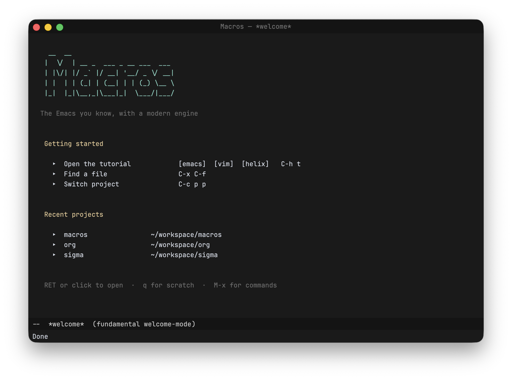

# Macros

Macros is a code editor that works like Emacs, renders on the GPU, and is scripted in [Steel](https://github.com/mattwparas/steel), a Scheme you can embed.



I wanted an editor that keeps the parts of Emacs I love, like the keybindings, M-x, buffers, and the fact that you can change anything, without carrying forty years of Emacs Lisp and a single-threaded redisplay along with it. So the core is written in Rust on top of Zed's [GPUI](https://github.com/zed-industries/zed/tree/main/crates/gpui), and almost everything you actually touch is Steel code. That includes the commands, keymaps, modes, modeline, and even the git interface. It all lives in [`scheme/`](scheme), ships inside the binary, and you can read it, rebind it, or replace it from your own config.

Some things that already work:

- Emacs keybindings out of the box, with `(evil-mode)` or `(helix-mode)` if you'd rather go modal
- Tree-sitter highlighting, LSP, and debugging over DAP
- A magit-style git interface, dired, ediff, and a real terminal
- Org mode, org-roam, snippets, multiple cursors, and helm-style completion
- A spreadsheet-like grid buffer and text plotting, mostly because I wanted them
- A package system so you can pull in extra stuff from Git

It runs on macOS, Linux, and Windows.

## Getting it

Prebuilt, signed builds are on the [downloads page](https://macros.dev/download). On macOS the app updates itself. On Linux and Windows it tells you when there's a new version.

If you'd rather build it yourself, you need Rust. The toolchain is pinned in `rust-toolchain.toml`, so rustup will grab the right version for you.

```sh
git clone https://github.com/macros-app/macros
cd macros
cargo run --release
```

On Debian or Ubuntu you'll also need a few system libraries first:

```sh
sudo apt-get install build-essential pkg-config cmake perl \
  libwayland-dev libxkbcommon-dev libxkbcommon-x11-dev \
  libxcb1-dev libxcb-render0-dev libxcb-shape0-dev libxcb-xfixes0-dev \
  libfontconfig1-dev libfreetype6-dev libvulkan-dev libssl-dev
```

## First steps

When you first open it, press `C-h t` for the built-in tutorial. `M-x` lists every command and `C-h b` shows every key that's currently bound.

Your config is just a Steel program at `~/.config/macros/init.scm` (or under `$XDG_CONFIG_HOME` if you set it). It runs after the defaults load, so you can override anything you like. The [docs](https://macros.dev/docs) go into much more detail on configuration, scripting, and every built-in mode.

## Contributing

Bug reports and ideas are welcome in [GitHub issues](https://github.com/macros-app/macros/issues). Pull requests are welcome too. Please read [CONTRIBUTING.md](CONTRIBUTING.md) first. The short version is that contributions are MIT licensed and commits need a `Signed-off-by` line (`git commit -s`).

## License

MIT. See [LICENSE](LICENSE) and [THIRD-PARTY-LICENSES.md](THIRD-PARTY-LICENSES.md).
